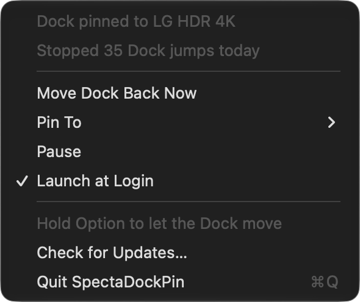

<!--
  @file        README.ko.md
  @description SpectaDockPin README (한국어). 영어판 README.md, 일본어판 README.ja.md와 내용이 같다.
  @author      Kennt Kim
  @company     Calida Lab
  @created     2026-10-19
  @lastUpdated 2026-10-19
-->

# SpectaDockPin

[English](README.md) · **한국어** · [日本語](README.ja.md)

[](https://github.com/kennss/SpectaDockPin/releases/latest)
[](https://github.com/kennss/SpectaDockPin/releases)
[](LICENSE)


<p align="center"></p>

모니터를 여러 대 쓰는 Mac에서는 Dock이 포인터를 따라다닙니다. 다른 화면 아래쪽에 포인터를 잠깐 두면 Dock이
그쪽으로 넘어갑니다. **SpectaDockPin은 Dock을 원하는 화면에 붙잡아 둡니다.** Dock을 부르는 포인터 이벤트만
골라 막고, 그래도 Dock이 다른 곳에 가 있으면 데려옵니다. Calida Lab Specta 제품군의 작은 메뉴바 앱입니다.

## 다운로드

**[⬇ 최신 DMG 받기](https://github.com/kennss/SpectaDockPin/releases/latest)**. 열고 **SpectaDockPin**을
응용 프로그램 폴더로 끌어 놓으면 됩니다. Developer ID로 서명하고 Apple 공증을 받았습니다. 업데이트는 앱이
알아서 합니다(메뉴의 **Check for Updates…**).

처음 실행하면 필요한 권한 하나를 요청합니다. 앱이 포인터를 제어하도록 허용하는 개인정보 보호 설정입니다
(**손쉬운 사용**, macOS 27에서는 **Device Control and Data Access**). 거기서 SpectaDockPin을 켜면 바로
Dock을 지키기 시작합니다.

> **이 권한을 끄기 전에 SpectaDockPin을 먼저 종료하세요.** 앱의 이벤트 탭이 켜진 채로 권한을 끄면 키보드와
> 마우스 입력이 전부 멈춰 재시동해야 했다는 보고가 있고(macOS 15–27), 아직 해결되지 않았습니다.

## 왜 SpectaDockPin인가

저는 모니터 세 대로 일하는데, Dock이 자꾸 방금 쓴 화면으로 넘어갔습니다. 옆 화면 아래쪽에 포인터를 두기만
하면 Dock이 있어야 할 자리에서 사라졌습니다. "디스플레이마다 별도의 Spaces"를 끄면 해결되지만, 그러면
다른 화면에서 메뉴 막대와 전체 화면 앱까지 잃습니다.

써 본 오픈소스 고정 앱들은 하나씩 모자랐습니다. 가장 나은 것도 파일을 끌 때는 Dock을 놓쳤고, 아래 10픽셀
띠를 통째로 막아 화면 아래쪽 호버가 죽었습니다. 잠자기에서 깨어날 때마다 커서를 움직이면서 Dock이 정말
돌아왔는지는 확인하지 않았습니다. 다른 하나는 좌표계를 섞어 써서 위아래로 놓인 화면에서 엉뚱한 곳을
막았습니다. 또 하나는 macOS가 이벤트 탭을 한 번 끄면 다시 켜지 않았습니다.

그래서 먼저 Dock이 실제로 어떻게 넘어가는지 쟀습니다. 그다음 그걸 막는 가장 작은 장치를 만들었습니다.
측정 결과는 모두 [`Docs/DESIGN.md`](Docs/DESIGN.md)에 있습니다.

## 동작 방식

- **맨 아래 한 줄만.** Dock은 다른 화면의 맨 아래 1포인트 줄에 포인터 이벤트가 0.4초쯤 이어질 때만 그
  화면으로 넘어갑니다. SpectaDockPin은 바로 그 이벤트(이동과 드래그)만 버리고 나머지는 건드리지 않습니다.
  클릭, 한 픽셀 위의 호버, 핫 코너, 다른 모든 가장자리는 그대로 동작합니다.
- **확인하고 나서 고칩니다.** 잠자기에서 깨어날 때나 화면 구성이 바뀔 때, 앱이 꺼져 있던 동안에는 Dock이
  다른 곳에 가 있을 수 있습니다. SpectaDockPin은 Dock이 실제로 어디 있는지 읽습니다. 화면이 잠겨 있지 않고,
  버튼이 눌려 있지 않고, 마우스를 쓰고 있지 않을 때만 고정 화면 아래 끝으로 포인터를 내려 Dock을 데려옵니다.
  그다음 포인터를 원래 자리로 돌려놓고 Dock이 도착했는지 확인합니다. 몇 번 시도해도 안 되면 메뉴에 그렇다고
  표시합니다.
- **일부러 옮길 때는 Option.** Option을 누른 채 아래 끝을 밀면 Dock을 통과시킵니다. 그렇게 옮긴 Dock은
  **Move Dock Back Now**를 누를 때까지 그 자리에 둡니다.
- **그 밖에는 아무것도 하지 않습니다.** 키보드를 읽지 않고 아무것도 수집하지 않습니다. 네트워크는 업데이트
  확인에만 씁니다.

## 메뉴

<p align="center"></p>

- **Pin To**: 주 화면(기본값. 주 화면이 바뀌면 따라갑니다) 또는 연결된 아무 화면. 고른 화면을 뽑아도
  기억해 두고, 다시 꽂을 때까지는 주 화면이 대신합니다.
- **Move Dock Back Now**, **Pause**, **Launch at Login**(직접 켜기 전까지 꺼져 있음), **Check for
  Updates…**.
- 쉬고 있을 때는 상태 줄에 이유가 나옵니다. 화면이 하나뿐일 때, Dock이 왼쪽이나 오른쪽에 있을 때,
  "디스플레이마다 별도의 Spaces"가 꺼져 있을 때, 권한이 없을 때입니다.

## 요구 사항과 한계

- macOS 14 이상. 개발과 측정은 macOS 27, Apple Silicon, 모니터 세 대에서 했습니다.
- Dock이 화면 아래쪽에 있고, "디스플레이마다 별도의 Spaces"가 켜져 있어야 합니다(꺼져 있으면 macOS가
  알아서 Dock을 주 화면에 둡니다).
- Apple이 문서로 밝히지 않은 지금의 Dock 동작에 기댑니다. macOS를 업데이트한 뒤에는 `tools/DockProbe`로
  측정을 다시 돌릴 수 있습니다. Dock을 찾지 못하면 짐작하지 않고 쉽니다.

## 소스에서 빌드

```sh
brew install xcodegen
xcodegen generate                    # SpectaDockPin.xcodeproj 생성(저장소에는 없음)
xcodebuild -scheme SpectaDockPin -destination 'platform=macOS' test
open SpectaDockPin.xcodeproj
```

먼저 `project.yml`의 `DEVELOPMENT_TEAM`을 자신의 팀으로 바꾸세요. 개발 빌드는 `/Applications`에서 실행하고 매번 같은
인증서로 서명하세요. 그러지 않으면 다시 빌드할 때마다
권한이 풀립니다. `scripts/release.sh`는 서명·공증된 DMG와 Sparkle appcast를 만듭니다. `tools/DockProbe`
(`xcrun swift build`)는 설계서 측정에 쓴 명령줄 도구이고, `tools/AppIcon/make_icon.swift`가 아이콘을
그립니다.

## 라이선스

[MIT](LICENSE) © 2026 Kennt Kim (Calida Lab)
